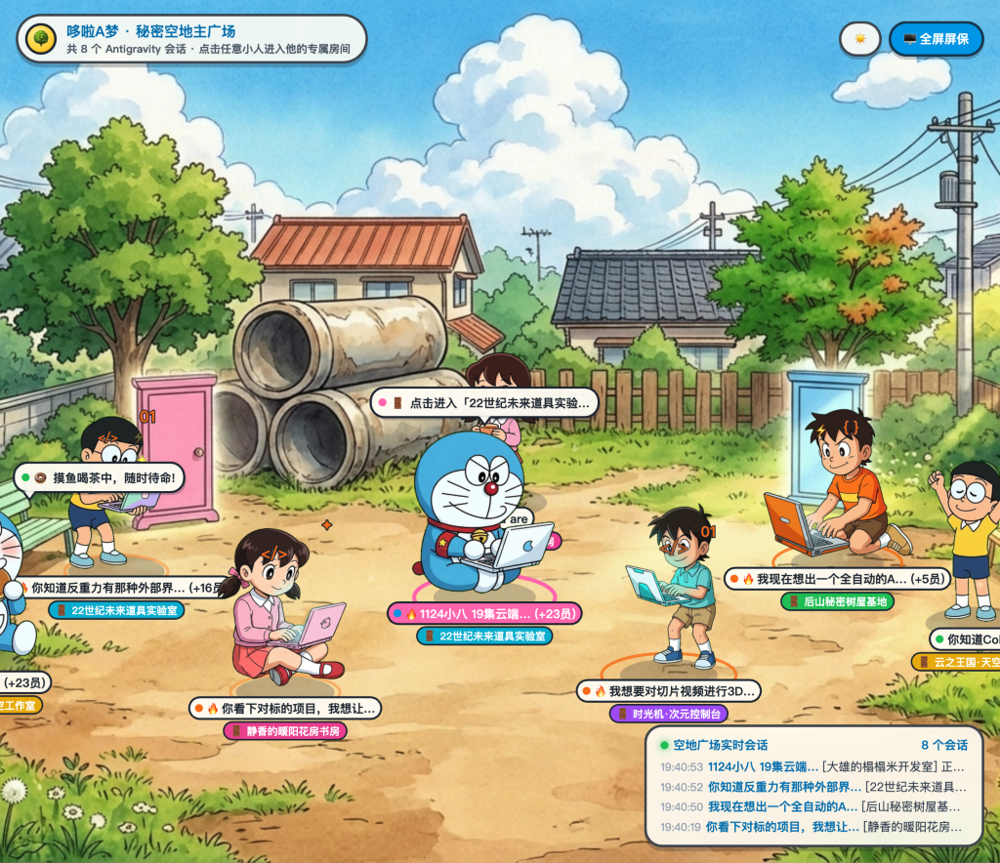
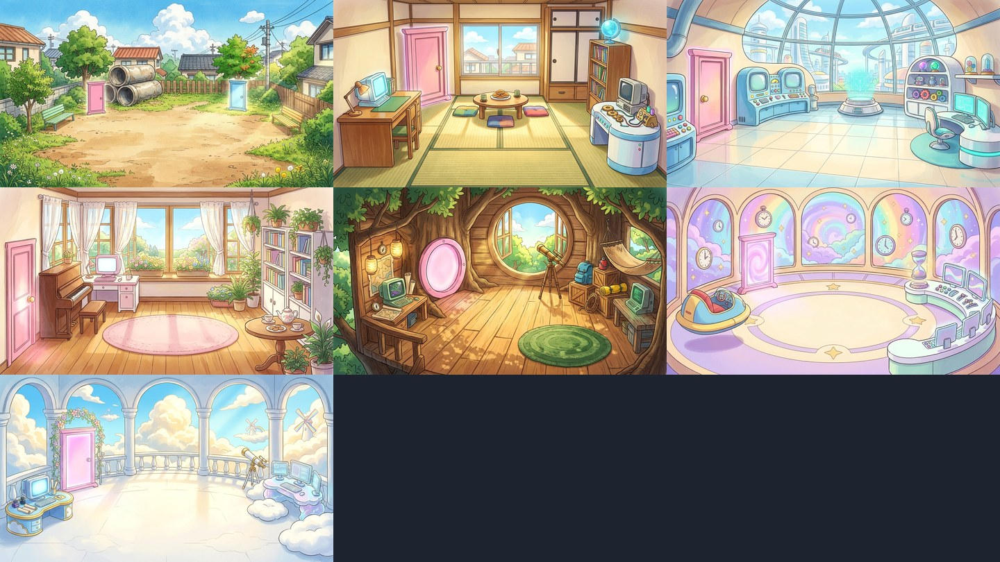

# 🔔 哆啦A梦 · Antigravity 多 Agent 秘密基地 (`doraemon-agent-office`)

> 把你本地正在运行的 **Google Antigravity** 所有主会话、Subagent 与 Swarm 蜂群组员，变成一座会呼吸、会敲电脑、拥有多间主题秘密房间的 **哆啦A梦风格可视化社区与全屏屏保桌面应用**。



## ✨ 核心特性

1. **主界面「野比社区空地广场」：每个小人 = 一个 Antigravity 会话**
   - 自动实时扫描本地 `~/.gemini/antigravity/brain/*/.system_generated/logs/transcript.jsonl` 与后台任务日志（`.system_generated/tasks/`），原生兼容 **主控会话**、`invoke_subagent` 子 Agent 以及 `/teamwork` **Swarm 蜂群组员**。
   - 每个会话以不同哆啦A梦风格角色出现在空地上，干活时脚下亮起脉冲环、专注敲电脑并飘出代码粒子，同时显示在线组员数量与专属房间标签。

2. **点击任意小人 → 穿过粉色「任意门」进入他的专属主题房间**
   - 点击主广场上的任意角色，即可触发粉色任意门转场动画，进入该会话独有的主题房间，实时观看**组长带着所有子 Agent / Swarm 组员全员用电脑协作**。
   - **内置 6 套独立手绘风哆啦A梦主题房间**（支持自动分配不同房间，也可在房内点击 `🏠 换间房` 自由切换）：
     - `大雄的榻榻米开发室`
     - `22世纪未来道具实验室`
     - `静香的暖阳花房书房`
     - `后山秘密树屋基地`
     - `时光机·次元控制台`
     - `云之王国·天空工作室`



3. **全员独立生图 + 电脑工作专属动作**
   - 5 套原创哆啦A梦 1990s 赛璐璐风格角色（蓝胖子组长、眼镜代码手、蝴蝶结调研员、橘衣实干家、绿衣侦探），全员均配备**专属笔记本电脑工作动作**、待机休息、跑动派活与灵光庆祝 4 态透明帧。
   - 提供绿幕一键抠图切图脚本 [`scripts/process_doraemon_sprites.py`](scripts/process_doraemon_sprites.py)，随时可自行生图扩展新角色。

4. **极简纯展示界面 + 全屏屏保 + 原生 macOS 桌面应用**
   - 无多余冗余按钮，专注实时观赏与陪伴；点击 **`🖥️ 全屏屏保`**（或按 `F` 键）进入全屏后，鼠标静止 3 秒自动隐藏全部控件，仅保留左上角极简时钟与实时小队状态。
   - 支持 **原生 macOS `.app` 封装**（Objective-C + `WKWebView`，仅 ~93KB 轻量可执行文件，自带哆啦A梦敲电脑应用图标，双击即自动拉起后台服务并打开独立窗口）。
   - 支持通过 `WebViewScreenSaver` 直接设置为 **macOS 系统级屏幕保护程序**。

---

## 🚀 快速开始

### 方式一：直接运行原生 macOS 桌面应用（推荐）
构建并安装到本机「应用程序」目录：

```bash
cd doraemon-agent-office
uv venv .venv && uv pip install --python .venv/bin/python flask pillow numpy
bash scripts/build_macos_app.sh
cp -R 哆啦A梦秘密基地.app /Applications/
```

之后直接在 **Launchpad / 应用程序 / Spotlight** 中搜索打开 **「哆啦A梦秘密基地」** 即可。

### 方式二：命令行启动网页版

```bash
cd doraemon-agent-office
.venv/bin/python backend/doraemon_app.py
```

浏览器打开 **http://127.0.0.1:19000** 即可访问；也可以直接双击项目根目录的：
- `启动哆啦A梦基地.command`（普通窗口打开）
- `全屏屏保启动.command`（纯净零按钮全屏屏保模式：`http://127.0.0.1:19000/?screensaver=1`）

### 方式三：设为 macOS 系统屏保

```bash
bash scripts/install_macos_screensaver.sh
```

脚本会自动注册后台常驻 LaunchAgent 并通过 Homebrew 安装开源的 `WebViewScreenSaver`。随后打开 macOS **系统设置 → 屏幕保护程序 → WebViewScreenSaver → 选项**，填入：

```text
http://127.0.0.1:19000/?screensaver=1
```

---

## 🎮 快捷键与操作

| 操作 / 快捷键 | 说明 |
| --- | --- |
| **点击空地上任意小人** | 穿过粉色任意门进入该会话的专属房间 |
| **点击房间内任意小人** | 查看该 Agent 的只读状态卡片（工具、步数、任务摘要） |
| **`⬅️ 返回广场`** / `Esc` / `Backspace` | 从房间返回野比社区空地主广场 |
| **`🏠 换间房`** | 为当前会话切换其他主题房间（自动本地记忆） |
| **`☀️`** | 切换晴朗午后 / 夕阳余晖 / 深夜加班 / 自动时段光影 |
| **`🖥️ 全屏屏保`** / `F` | 进入/退出全屏屏保模式（静止 3 秒自动隐藏控件） |

---

## 🎨 扩展自定义角色

使用任意生图模型生成 **纯 `#00FF00` 绿幕背景** 的 2×2 四态图（左上待机 / 右上用电脑 / 左下跑动 / 右下庆祝）或单张动作图，运行脚本即可自动抠图去绿边并脚底对齐：

```bash
# 2x2 四态角色图
.venv/bin/python scripts/process_doraemon_sprites.py <你的原图.jpg> frontend/assets/doraemon/sprites <角色ID>

# 单张动作图
.venv/bin/python scripts/process_doraemon_sprites.py --single <单张图.jpg> frontend/assets/doraemon/sprites/<角色ID>_work.png
```

---

## 📁 目录结构

```text
doraemon-agent-office/
├── backend/
│   ├── antigravity_watcher.py   # 实时解析本地 Antigravity 会话、Subagent 与 Swarm 日志
│   └── doraemon_app.py          # Flask 服务 (/api/antigravity/hub, /api/antigravity/room/<cid>)
├── frontend/
│   ├── doraemon.html            # 极简展示与全屏屏保主页面
│   ├── doraemon.css             # 哆啦A梦圆润漫画风样式与任意门转场动效
│   ├── doraemon.js              # 60fps Canvas 主广场 + 6间主题房 + 电脑工作粒子引擎
│   └── assets/doraemon/         # 1张主广场 + 6间主题房背景 + 5角色×4态透明帧
├── mac_app/
│   └── DoraemonApp.m            # 原生 macOS Cocoa + WKWebView 桌面应用源码
└── scripts/
    ├── build_macos_app.sh       # 一键编译打包 哆啦A梦秘密基地.app（含自定义图标）
    ├── install_macos_screensaver.sh  # 一键配置 macOS 系统屏保
    └── process_doraemon_sprites.py   # 绿幕自动抠图与脚底对齐工具
```

---

## 🙏 致谢

本项目基于开源项目 [ringhyacinth/Star-Office-UI](https://github.com/ringhyacinth/Star-Office-UI) 克隆并深度改造，面向 Google Antigravity 多 Agent / Swarm 场景重新设计了空地主广场、6 间哆啦A梦主题房间、全员电脑工作精灵帧与原生 macOS 桌面应用封装。
